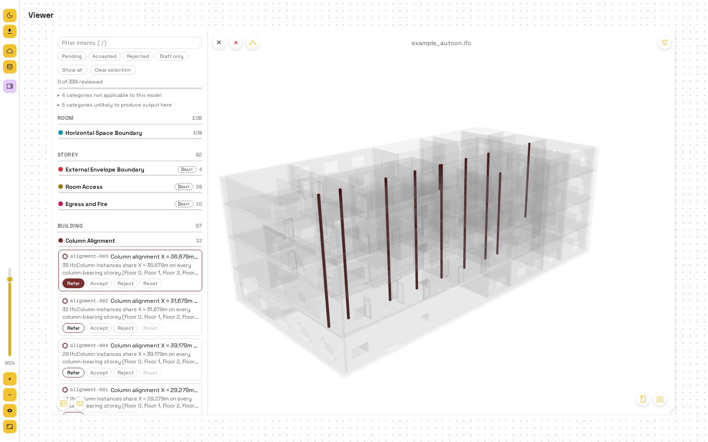

# bi2m: Building Intent Information Modeling

bi2m adds design intent to building information modeling. It recognises the
intent in an IFC building model (aligned columns, door and room graphs,
egress, daylight, Neufert rules, ...) and stores it as **intent records**:
groups of elements plus the evidence for them, kept beside the model. A
browser viewer shows each record on the model so a person can accept or
reject it.



```
IFC file ──> src/extraction ──> src/recognition ──> JSON shard per model ──> viewer
```

## Getting started

Two ways to run it, both on http://localhost:3000: **uv** to work on the code
(the viewer reloads as you edit), **Docker** to just use it. Get the code first
(needs [git](https://git-scm.com/downloads)):

```bash
git clone https://github.com/Jaaaaabin/bi2m.git
cd bi2m
```

### Develop with uv

Needs [uv](https://docs.astral.sh/uv/getting-started/installation/) (it
installs Python 3.12 itself) and [Node 24](https://nodejs.org/en/download)
(`node --version` prints `v24.x`). Linux, macOS, Windows (x64); on Windows on
ARM use Docker, as ifcopenshell has no build for it.

```bash
uv sync
cd viewer
npm ci
npm run dev        # live reload
```

### Host with Docker

Needs Docker with the Compose and Buildx plugins: Docker Desktop (Windows,
macOS) has both; on Linux install
[Docker Engine](https://docs.docker.com/engine/install/) (with Ubuntu's
`docker.io`, add `sudo apt install docker-compose-v2 docker-buildx`).

```bash
docker compose up -d --build    # first build: several minutes, about 1.3 GB
```

`docker compose down` stops it; models and results stay in `data/` and in
Docker volumes. The server has no login and listens on `127.0.0.1` only: read
[SECURITY.md](SECURITY.md) before you expose it.

<details>
<summary>Plain Docker, without the Compose plugin (Linux, bash)</summary>

```bash
docker build -t bi2m .
docker run -d --name bi2m --restart unless-stopped \
  -p 127.0.0.1:3000:3000 --user "$(id -u):$(id -g)" \
  -v "$PWD/data:/app/data" \
  -v bi2m-intents:/app/viewer/public/res/intents \
  -v bi2m-tiles:/app/viewer/public/tiles \
  bi2m
```

</details>

### Settings and first run

Settings go in a `.env` at the repository root: copy `.env.example`, which
documents every variable. In the viewer, pick `example_autcon` (the one model
in the repository) or drop your own `.ifc` onto a tile, then press **Compute**.

## Command line

From the repository root:

```bash
uv run python scripts/recognize_intents.py                    # all categories, every .ifc in data/
uv run python scripts/recognize_intents.py --files model.ifc --categories structural
uv run python scripts/recognize_intents.py --list-categories
```

Results go to `viewer/public/res/intents/<contentKey>.json`.

## Layout

| Path | What |
|---|---|
| `src/recognition/`, `src/extraction/`, `src/modality/` | detectors and category registry, per-element data, declared grids and facade bands |
| `config/neufert/` | Neufert rules as data |
| `scripts/` | command-line tools and `verify_*.py` checks ([what each is for](CONTRIBUTING.md#scripts)) |
| `viewer/` | the viewer, its server (`server/`) and tests |
| `data/` | the example model; your models, uploads and caches (not in git) |

## Where to go next

| I want to | Read |
|---|---|
| understand how the parts fit together | [docs/architecture.md](docs/architecture.md) |
| see what each category detects, or add a detector | [docs/detectors.md](docs/detectors.md), "Writing a detector" |
| run the checks before a push, or find the right script | [CONTRIBUTING.md](CONTRIBUTING.md) |
| look up a term (content key, shard, intent record, ...) | [GLOSSARY.md](GLOSSARY.md) |
| see what is not built yet | [docs/roadmap.md](docs/roadmap.md) |
| report a security problem | [SECURITY.md](SECURITY.md) |

Before you change code: a model is identified by its **content key** (a hash
of its bytes), never its file name; record ids must be reproducible from run to
run; the four verified categories (`alignment`, `connection`, `structural`,
`vertical`) and `data/example_autcon.ifc` are not edited; never commit an
absolute path. Then run the checks in [CONTRIBUTING.md](CONTRIBUTING.md).

## License

[MIT](LICENSE). The example model `data/example_autcon.ifc` is
[CC BY 4.0](https://creativecommons.org/licenses/by/4.0/). The viewer's font,
Space Grotesk, is under the SIL Open Font License 1.1
([`viewer/public/fonts/OFL.txt`](viewer/public/fonts/OFL.txt)).
